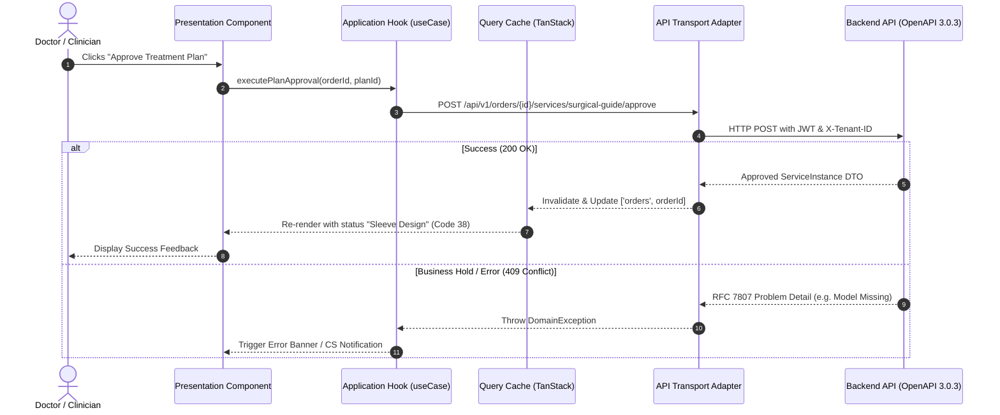
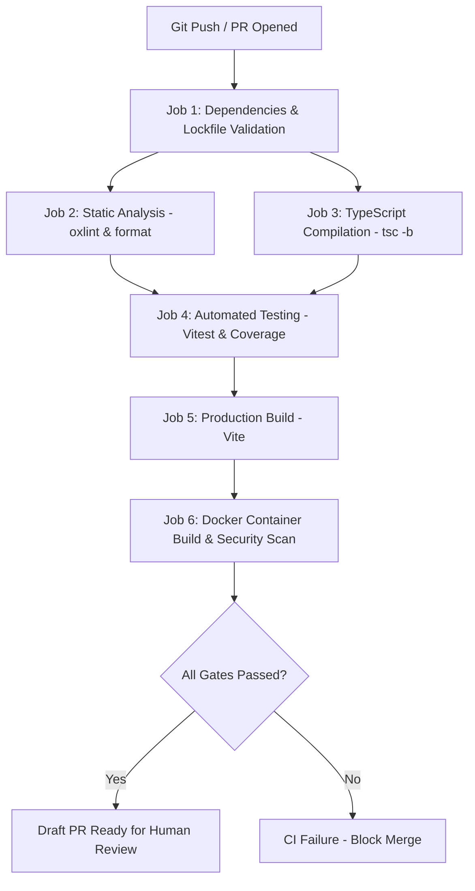
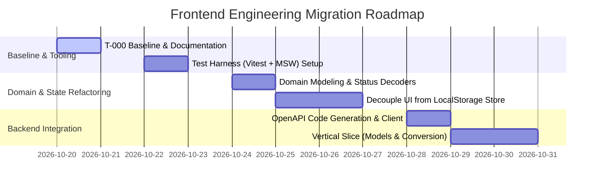

# Project Software Design Specification (SDS): 3DDX CP PRO MAX

**Document Identifier:** `SDS-3DDX-PROJECT-2026-V1.0`  
**Classification:** Enterprise Software Engineering & Architecture Specification  
**Standard Compliance:** IEEE Std 1016-2009 (Systems and Software Engineering — Software Design Descriptions)  
**Scope:** Whole-Project Frontend Architecture (`newcp-ui-option-a`)  
**Workspace:** `H:\3DDX\DEMO\newcp-ui-option-a`  
**Primary Domain Authority:** `H:\3DDX\02 Backend\New DB V3\03 BUSINESS_GUIDE.html`  
**API Specification:** OpenAPI 3.0.3 (`openapi/newcp.openapi.yaml` pending formal ingestion)  

---

## 1. Introduction & Executive Architectural Overview

This Software Design Specification (SDS) defines the structural, behavioral, and engineering architecture for the **3DDX CP PRO MAX Frontend** (`newcp-ui-option-a`). 

The primary design goal is transitioning the application from a coupled, mock-dependent prototype into a resilient, enterprise-grade clinical frontend governed by **Clean Architecture** and **Ports & Adapters (Hexagonal Architecture)** principles.

*Component Specification Note:* A pre-existing component-level SDS (`docs/90_PRODUCT_REFERENCE/SDS_SOFTWARE_DESIGN_SPECIFICATION.md`) governs the isolated Three.js 3D Odontogram rendering engine. This document establishes the **system-wide architecture** covering state management, network transport, security, domain invariants, containerization, and CI/CD engineering.

---

## 2. Current Architecture vs. Target Clean Architecture

### 2.1 Current-State Architecture (POC Baseline)
In the current implementation:
- **Presentation & State Coupling:** UI pages (`src/pages/*.tsx`) import the singleton `store` (`src/services/store.ts`) directly.
- **LocalStorage as Single Source of Truth:** `ReactiveStore` synchronizes all entity mutations to browser `localStorage` under `dentalab_store_*`.
- **Static JSON Fetching:** `src/services/api.ts` performs direct `fetch()` calls against static JSON files in `/data/*.json` and simulates database joins and filtering in client memory.
- **Generic Data Models:** The domain models in `src/types/index.ts` use generic string enumerations (`OrderStatus = 'New' | 'Review' | 'Design' ...`) which contradict the product-specific status codes defined by the 3DDX Business Guide.

```
[Current POC Flow]
[React UI Page] <---> [ReactiveStore (localStorage)] <---> [api.ts (fetch '/data/*.json')]
```

### 2.2 Target Architecture (Clean Architecture / Hexagonal)
The target architecture enforces a strict unidirectional dependency rule: **Dependencies point inward. Inner layers know nothing of outer layers.**

```
+-----------------------------------------------------------------------------------+
| 1. PRESENTATION LAYER (React Components, Tailwind UI, Three.js 3D Viewers)       |
+-----------------------------------------------------------------------------------+
                                          | uses
                                          v
+-----------------------------------------------------------------------------------+
| 2. APPLICATION LAYER (Use Cases, State Selectors, Query/Mutation Hooks)          |
+-----------------------------------------------------------------------------------+
                     | uses                               | uses
                     v                                    v
+---------------------------------------+  +----------------------------------------+
| 3. DOMAIN LAYER (Pure TypeScript)     |  | 4. INFRASTRUCTURE & TRANSPORT ADAPTERS |
| - Service Line Entities & Invariants  |  | - OpenAPI 3.0.3 HTTP Client (Axios/Ky) |
| - Registration Verdict State Machine  |  | - Auth & Token Store (Web Crypto/RAM)  |
| - Voucher Ledger Calculator           |  | - Mock Service Worker (MSW) Adapter    |
| - Product Status Decoders             |  | - S3/GCS Direct Upload Engine          |
+---------------------------------------+  +----------------------------------------+
```

---

## 3. Layer Responsibilities & Module Boundaries

### 3.1 Domain Layer (`src/domains/`)
- **Nature:** Pure, framework-agnostic TypeScript modules. Zero dependencies on React, DOM, or browser storage APIs.
- **Responsibilities:**
  - Encapsulate clinical and business invariants (e.g. registration support validation, approval gate enforcement before printing, 16-step implant site price calculations).
  - Define domain entities: `Account`, `Case`, `Order`, `ServiceInstance`, `VoucherTransaction`, `BatchRecord`.
  - Provide deterministic status decoders converting legacy integer codes to human-readable clinical statuses per product line.

### 3.2 Application Layer (`src/app/` & Domain Hooks)
- **Nature:** Coordinates interactions between domain rules and external infrastructure ports.
- **Responsibilities:**
  - Exposes use cases (e.g. `submitCaseWithOdontogram`, `evaluateRegistrationVerdict`, `executeDoctorApprovalGate`).
  - Implements server-state management using TanStack Query (React Query) for caching, optimistic updates, and background synchronization.
  - Manages ephemeral UI state (modals, active tabs, drawer toggles) using lightweight reactive stores.

### 3.3 Infrastructure & Transport Layer (`src/shared/api/`)
- **Nature:** Concrete implementations of application ports.
- **Responsibilities:**
  - **HTTP Client Adapter:** Intercepts requests to inject JWT `Authorization: Bearer <token>` and `X-Tenant-ID` headers.
  - **Correlation Tracking:** Attaches `X-Correlation-ID` (UUIDv4) to every outbound request for end-to-end distributed tracing.
  - **Error Normalization:** Converts RFC 7807 problem details from backend into strongly-typed frontend domain errors (`ConflictError`, `ValidationError`, `TenantAccessDeniedError`).

### 3.4 Presentation Layer (`src/components/` & `src/pages/`)
- **Nature:** React functional components styled with Tailwind CSS v4.
- **Responsibilities:**
  - Render data received from application hooks.
  - Delegate user interactions directly to use-case handlers.
  - Adhere strictly to WCAG 2.1 AA accessibility and bilingual LTR/RTL responsiveness.

---

## 4. State Management and Data Flow

### 4.1 Data Flow Taxonomy
To avoid state synchronization bugs, state is classified into four distinct categories:

| State Category | Definition & Scope | Target Technology | Example |
|---|---|---|---|
| **Server State** | Data owned and persisted by the backend API. | TanStack Query (React Query) | Cases list, order details, voucher transactions, client price lists. |
| **Client Session State** | Authenticated user profile, tenant context, active permissions. | React Context + Memory Store | Active Doctor Account, Casbin role matrix, active tenant ID. |
| **Ephemeral UI State** | Local component state with zero business persistence. | `useState`, `useReducer` | Modal open/close state, table sorting/filtering criteria, active step. |
| **Clinical CAD State** | High-frequency 3D scene data and mesh coordinates. | Three.js Scene Graph + Refs | Camera position, tooth hover highlights, implant thread rotation. |

### 4.2 Data Flow Diagram (Unidirectional)


---

## 5. Mock-to-Real API Migration Boundary

To ensure development continuity while the backend repository is prepared:

### 5.1 Abstract API Client Interface
All application modules consume an abstract interface rather than concrete fetch routines:
```typescript
export interface IApiClient {
  cases: {
    list(params: CaseQueryParameters): Promise<PaginatedResult<CaseSummary>>;
    getById(id: string): Promise<CaseDetails>;
    create(payload: CreateCasePayload): Promise<CaseDetails>;
  };
  services: {
    getRegistration(instanceId: string): Promise<RegistrationService>;
    submitRegistrationVerdict(instanceId: string, verdict: RegistrationVerdictPayload): Promise<void>;
    approvePlan(instanceId: string, approval: PlanApprovalPayload): Promise<void>;
  };
  billing: {
    getVoucherLedger(accountId: string): Promise<VoucherTransaction[]>;
  };
}
```

### 5.2 Mock Service Worker (MSW) Adapter
- During local development and automated testing, MSW intercepts network requests at the browser Service Worker layer.
- MSW handlers match the exact paths, parameters, and response schemas specified in `openapi/newcp.openapi.yaml`.
- When switching to live staging or production, MSW is completely omitted from the bundle, and requests route directly to `VITE_API_BASE_URL`.

---

## 6. Authentication, Tenant Isolation & Privacy Boundaries

### 6.1 Authentication Lifecycle (OAuth 2.0 PKCE)
1. Clinician initiates login via `/login` -> Redirects to Google Identity Provider.
2. Google redirects back with authorization code to `/auth/callback`.
3. Frontend exchanges authorization code for:
   - **Access Token:** Short-lived JWT stored **only in memory** (never in `localStorage` or `sessionStorage` to mitigate XSS attacks).
   - **Refresh Token:** Stored in an `HttpOnly`, `Secure`, `SameSite=Strict` cookie managed by the authentication backend.
4. An Axios/Fetch response interceptor automatically triggers silent token refresh upon encountering HTTP `401 Unauthorized`.

### 6.2 Tenant Isolation Safeguards
- Every request includes the active tenant identifier extracted from the user's validated session token.
- Multi-tenant accounts (such as DSOs managing multiple clinic branches) must switch tenants via an explicit UI selector, triggering a complete flush of the query cache to prevent cross-tenant data leakage.

### 6.3 Patient Privacy (HIPAA / GDPR Protection)
- In compliance with Section 13.9 of the 3DDX Business Guide, the default patient representation contains only the pseudonymous `patient_code`.
- True patient identities (name, date of birth, contact information) are quarantined. 
- Accessing patient identities requires clicking an explicit "View Patient Details" action, which dispatches a purpose-annotated audit request to `/api/v1/clinical/patients/{id}/identity-access`.

---

## 7. Clean Code and Engineering Invariants

1. **Explicit Typing:** Strict TypeScript with `noImplicitAny: true` and `strictNullChecks: true`.
2. **Pure Business Logic:** Status decoders, pricing arithmetic, and validation functions must be pure functions with 100% unit test coverage.
3. **No Impure Operations in Render:** Components must not invoke non-deterministic functions (`Date.now()`, `Math.random()`, `uuid()`) during render phase. All IDs and timestamps must be generated in event handlers or use cases.
4. **Single Responsibility Principle (SRP):** Presentation components handle display and styling; custom hooks handle state and side effects; services handle data mapping.

---

## 8. CI/CD Architecture and GitHub Actions

### 8.1 GitHub Actions Workflow Pipeline
The continuous integration pipeline is structured as an automated multi-stage gate:



### 8.2 Environment Variables & Secrets Governance
The frontend requires the following environment variables. **No secret values are ever committed to the repository:**

| Variable Name | Environment | Description | Sensitivity |
|---|---|---|---|
| `VITE_API_BASE_URL` | Staging / Prod | Root URL of New CP Backend API Gateway | Public / Config |
| `VITE_GOOGLE_CLIENT_ID` | Staging / Prod | Google OAuth 2.0 Client Identifier | Public / Config |
| `VITE_APP_ENV` | All | `development`, `staging`, `production` | Public / Config |
| `VITE_ENABLE_MOCKS` | Dev / Staging | Boolean toggle enabling MSW network simulation | Public / Config |

---

## 9. Docker and Containerization Strategy

### 9.1 Multi-Stage Production Dockerfile Design
A standardized, unprivileged container architecture for production static hosting:

```dockerfile
# Stage 1: Build Environment
FROM node:22-alpine AS builder
WORKDIR /app
COPY package.json package-lock.json ./
RUN npm ci --prefer-offline --no-audit
COPY . .
RUN npm run build

# Stage 2: Hardened Nginx Runtime
FROM nginx:alpine AS runner
WORKDIR /usr/share/nginx/html
# Security: Remove default Nginx welcome assets
RUN rm -rf ./*
# Copy compiled static assets from builder
COPY --from=builder /app/dist .
# Copy custom Nginx configuration
COPY deploy/nginx.conf /etc/nginx/conf.d/default.conf

# Security: Run as unprivileged nginx user
USER nginx
EXPOSE 8080
HEALTHCHECK --interval=30s --timeout=3s --retries=3 \
  CMD wget --quiet --tries=1 --spider http://localhost:8080/health || exit 1
CMD ["nginx", "-g", "daemon off;"]
```

### 9.2 Custom Nginx Routing & Security Headers (`deploy/nginx.conf`)
- **SPA Fallback Routing:** `try_files $uri $uri/ /index.html;` ensures React Router handles deep links correctly without 404 errors.
- **Security Headers:**
  - `Content-Security-Policy: default-src 'self'; script-src 'self' 'unsafe-inline'; style-src 'self' 'unsafe-inline'; img-src 'self' data: blob:; connect-src 'self' https://api.3ddx.com;`
  - `X-Frame-Options: SAMEORIGIN`
  - `X-Content-Type-Options: nosniff`
  - `Referrer-Policy: strict-origin-when-cross-origin`

---

## 10. Automated Testing Strategy

To eliminate regressions and guarantee business compliance:

| Test Level | Target Framework | Scope & Coverage Targets | Execution Trigger |
|---|---|---|---|
| **Unit Tests** | Vitest | Pure domain functions, pricing calculators, status decoders, voucher drawdowns. Target: > 90% logic coverage. | Pre-commit / CI PR |
| **Component Tests** | Vitest + React Testing Library | UI components, form validations, accessibility keyboard traps, empty/error state handling. | Pre-commit / CI PR |
| **Contract / API Tests** | MSW + Vitest | Verifies that frontend API adapters correctly parse backend JSON payloads against OpenAPI schemas. | CI PR |
| **End-to-End (E2E)** | Playwright (Future Phase) | Critical user journeys: Case creation -> 3D Odontogram -> Approval Gate -> Billing dispatch. | Nightly / Pre-release |

---

## 11. Security, Compliance & Observability

1. **Zero Client Secrets:** All authentication exchanges use OAuth PKCE or server-side session cookies. No API private keys exist in client code.
2. **Cross-Site Scripting (XSS) Mitigation:** React's built-in JSX escaping prevents HTML injection. Raw SVG/HTML rendering is strictly prohibited without DOMPurify sanitization.
3. **Structured Telemetry:**
   - Production errors caught by React Error Boundaries are transmitted with correlation IDs, route context, and anonymized user IDs.
   - Client-side logging automatically strips potential PHI tokens (names, birth dates, phone numbers) before sending events to error collectors.

---

## 12. Phased Architecture Migration Roadmap



---

## 13. Architectural Decisions Requiring Human Approval

The following critical decisions require explicit sign-off from the Technical Lead and Product Owner before code execution:
1. **Selection of Unit Testing Engine:** Formal adoption of Vitest over Jest for alignment with Vite.
2. **Adoption of TanStack Query:** Replacing `ReactiveStore` with React Query for server-state synchronization.
3. **OpenAPI Specification Freeze:** Confirmation of the final OpenAPI 3.0.3 contract from the backend engineering team.
4. **Approval of FMP/GFMP Status Sequences:** Finalizing the open business question regarding whether FMP/GFMP are independent services, order forms, or bundled workflows.

---

*Authored under Task T-000 governance. Canonical project-level software design specification for `newcp-ui-option-a`.*