# Project Software Design Specification (SDS): 3DDX CP PRO MAX

**Document Identifier:** `SDS-3DDX-PROJECT-2026-V1.0`  
**Classification:** Enterprise Software Engineering & Architecture Specification  
**Standard Compliance:** IEEE Std 1016-2009 (Systems and Software Engineering — Software Design Descriptions)  
**Scope:** Whole-Project Frontend Architecture (`newcp-ui-option-a`)  
**Workspace:** `H:\3DDX\DEMO\newcp-ui-option-a`  
**Primary Domain Authority:** `H:\3DDX\02 Backend\New DB V3\03 BUSINESS_GUIDE.html`  
**API Specification:** OpenAPI 3.0.3 (`openapi/newcp.openapi.yaml` pending formal ingestion)  

---

## 1. Introduction & Executive Architectural Overview

This Software Design Specification (SDS) defines the structural, behavioral, and engineering architecture for the **3DDX CP PRO MAX Frontend** (`newcp-ui-option-a`). 

The primary design goal is transitioning the application from a coupled, mock-dependent prototype into a resilient, enterprise-grade clinical frontend governed by **Clean Architecture** and **Ports & Adapters (Hexagonal Architecture)** principles.

*Component Specification Note:* A pre-existing component-level SDS (`docs/90_PRODUCT_REFERENCE/SDS_SOFTWARE_DESIGN_SPECIFICATION.md`) governs the isolated Three.js 3D Odontogram rendering engine. This document establishes the **system-wide architecture** covering state management, network transport, security, domain invariants, containerization, and CI/CD engineering.

---

## 2. Current Architecture vs. Target Clean Architecture

### 2.1 Current-State Architecture (POC Baseline)
In the current implementation:
- **Presentation & State Coupling:** UI pages (`src/pages/*.tsx`) import the singleton `store` (`src/services/store.ts`) directly.
- **LocalStorage as Single Source of Truth:** `ReactiveStore` synchronizes all entity mutations to browser `localStorage` under `dentalab_store_*`.
- **Static JSON Fetching:** `src/services/api.ts` performs direct `fetch()` calls against static JSON files in `/data/*.json` and simulates database joins and filtering in client memory.
- **Generic Data Models:** The domain models in `src/types/index.ts` use generic string enumerations (`OrderStatus = 'New' | 'Review' | 'Design' ...`) which contradict the product-specific status codes defined by the 3DDX Business Guide.

```
[Current POC Flow]
[React UI Page] <---> [ReactiveStore (localStorage)] <---> [api.ts (fetch '/data/*.json')]
```

### 2.2 Target Architecture (Clean Architecture / Hexagonal)
The target architecture enforces a strict unidirectional dependency rule: **Dependencies point inward. Inner layers know nothing of outer layers.**

```
+-----------------------------------------------------------------------------------+
| 1. PRESENTATION LAYER (React Components, Tailwind UI, Three.js 3D Viewers)       |
+-----------------------------------------------------------------------------------+
                                          | uses
                                          v
+-----------------------------------------------------------------------------------+
| 2. APPLICATION LAYER (Use Cases, State Selectors, Query/Mutation Hooks)          |
+-----------------------------------------------------------------------------------+
                     | uses                               | uses
                     v                                    v
+---------------------------------------+  +----------------------------------------+
| 3. DOMAIN LAYER (Pure TypeScript)     |  | 4. INFRASTRUCTURE & TRANSPORT ADAPTERS |
| - Service Line Entities & Invariants  |  | - OpenAPI 3.0.3 HTTP Client (Axios/Ky) |
| - Registration Verdict State Machine  |  | - Auth & Token Store (Web Crypto/RAM)  |
| - Voucher Ledger Calculator           |  | - Mock Service Worker (MSW) Adapter    |
| - Product Status Decoders             |  | - S3/GCS Direct Upload Engine          |
+---------------------------------------+  +----------------------------------------+
```

---

## 3. High-Level UML Architecture & System Components

### 3.1 Component & Package Architecture Diagram
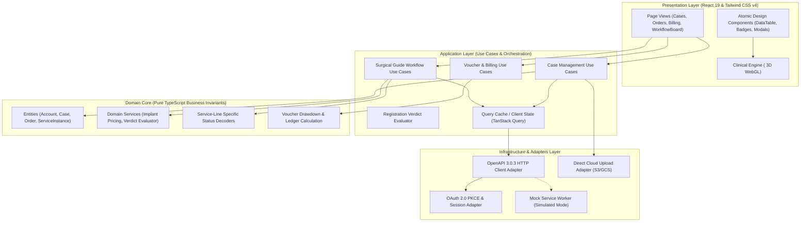

---

## 4. Comprehensive UML Class Diagrams

### 4.1 Domain Entity Hierarchy Class Diagram
The core business hierarchy strictly reflects Section 4 and Section 13 of the 3DDX Business Guide:

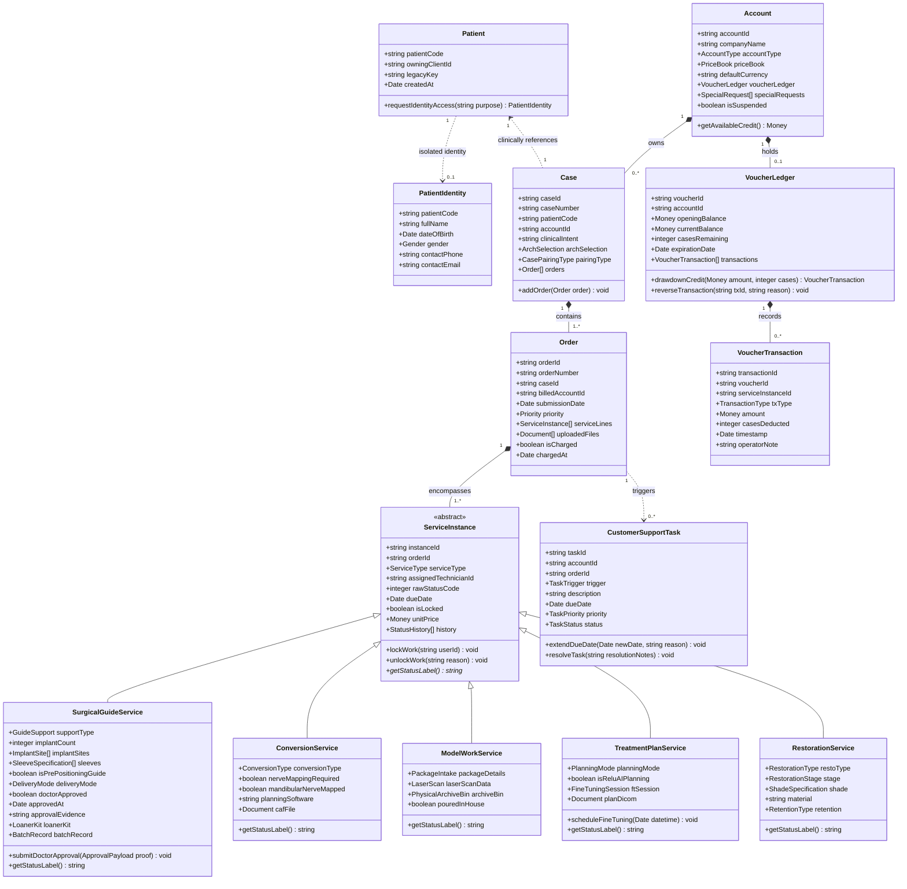

### 4.2 Clean Architecture Class Structure (Ports & Adapters)
```mermaid
classDiagram
    direction LR

    class ISurgicalGuideUseCase {
        <<interface>>
        +createGuideOrder(CreateGuideDTO dto) Promise~GuideDetails~
        +submitRegistrationOption(string instanceId, RegistrationVerdictDTO verdict) Promise~void~
        +recordDoctorApproval(string instanceId, ApprovalDTO proof) Promise~ServiceInstance~
        +fetchProductionBatch(string instanceId) Promise~BatchRecord~
    }

    class SurgicalGuideInteractor {
        -ISurgicalGuideRepository guideRepo
        -IRegistrationValidator validator
        -INotificationPort notifier
        +createGuideOrder(CreateGuideDTO dto) Promise~GuideDetails~
        +submitRegistrationOption(string instanceId, RegistrationVerdictDTO verdict) Promise~void~
        +recordDoctorApproval(string instanceId, ApprovalDTO proof) Promise~ServiceInstance~
        +fetchProductionBatch(string instanceId) Promise~BatchRecord~
    }

    class ISurgicalGuideRepository {
        <<interface>>
        +findById(string instanceId) Promise~SurgicalGuideService~
        +save(SurgicalGuideService guide) Promise~void~
        +recordApproval(string instanceId, ApprovalPayload payload) Promise~void~
    }

    class OpenApiGuideHttpAdapter {
        -HttpClient client
        +findById(string instanceId) Promise~SurgicalGuideService~
        +save(SurgicalGuideService guide) Promise~void~
        +recordApproval(string instanceId, ApprovalPayload payload) Promise~void~
    }

    class MswSimulatedGuideAdapter {
        -InMemoryDatabase db
        +findById(string instanceId) Promise~SurgicalGuideService~
        +save(SurgicalGuideService guide) Promise~void~
        +recordApproval(string instanceId, ApprovalPayload payload) Promise~void~
    }

    class UseSurgicalGuideViewModel {
        +guideData SurgicalGuideService
        +isLoading boolean
        +isApproving boolean
        +error string
        +onApprovePlan(ApprovalProof proof) void
        +onSubmitOption(RegistrationOption option) void
    }

    ISurgicalGuideUseCase <|.. SurgicalGuideInteractor
    SurgicalGuideInteractor --> ISurgicalGuideRepository
    ISurgicalGuideRepository <|.. OpenApiGuideHttpAdapter
    ISurgicalGuideRepository <|.. MswSimulatedGuideAdapter
    UseSurgicalGuideViewModel --> ISurgicalGuideUseCase
```

---

## 5. Comprehensive UML Use Case Diagrams

### 5.1 Global System Use Case Model
```mermaid
flowchart TD
    subgraph External_Actors ["External Commercial Actors"]
        Doctor["Dentist / OMFS Doctor"]
        ScanCenter["Scanning Centre"]
        LabPartner["Commercial Lab / Partner"]
        DsoAdmin["DSO Administrator"]
    end

    subgraph Internal_Actors ["Internal Operational Actors"]
        CS["Customer Support (Global)"]
        Planner["Treatment Planner (Cairo)"]
        FineTuner["Fine-Tuner / Clinician (Cairo)"]
        OpsCairo["Operations CAD Tech (Cairo)"]
        BostonTech["Boston Lab Technician (Boston)"]
        BostonShip["Boston Shipping & Logistics (Boston)"]
        FinanceUser["Finance Officer (Global)"]
    end

    subgraph Portal_Boundary ["3DDX CP PRO MAX Platform Boundaries"]
        UC01["Submit Case & Clinical Intent"]
        UC02["Interactive Odontogram Charting"]
        UC03["Upload CBCT Scans & Models"]
        UC04["Evaluate Registration Verdict (Options 1-4)"]
        UC05["3D Conversion & Nerve Canal Mapping"]
        UC06["CoDiagnostiX Virtual Implant Planning"]
        UC07["Conduct Live Fine-Tuning Session"]
        UC08["Approve Surgical Guide (Mandatory Gate)"]
        UC09["Sleeve Placement & CAD Guide Design"]
        UC10["Boston Physical Model Intake & Pouring"]
        UC11["3D Printing, Wash, Cure & QC Verification"]
        UC12["Assemble Loaner Kit & Dispatch Courier"]
        UC13["Process Voucher Drawdown & Charging"]
        UC14["Resolve Event-Driven Support Tasks"]
    end

    Doctor --> UC01
    Doctor --> UC02
    Doctor --> UC03
    Doctor --> UC07
    Doctor --> UC08

    ScanCenter --> UC01
    ScanCenter --> UC03

    LabPartner --> UC01
    LabPartner --> UC08

    DsoAdmin --> UC01
    DsoAdmin --> UC13

    OpsCairo --> UC04
    OpsCairo --> UC05
    OpsCairo --> UC09

    Planner --> UC06
    Planner --> UC09

    FineTuner --> UC07
    FineTuner --> UC08

    BostonTech --> UC10
    BostonTech --> UC11

    BostonShip --> UC12

    FinanceUser --> UC13

    CS --> UC14
    UC04 -.->|Option 3 or 4 Hold| UC14
    UC08 -.->|Unblocks| UC09
    UC09 -.->|Ready for Print| UC11
```

---

## 6. Comprehensive UML Sequence Diagrams

### 6.1 Canonical Surgical Guide Lifecycle Sequence
This sequence demonstrates the full flow from doctor submission to courier dispatch, highlighting the Cairo-Boston separation and the critical approval gate:

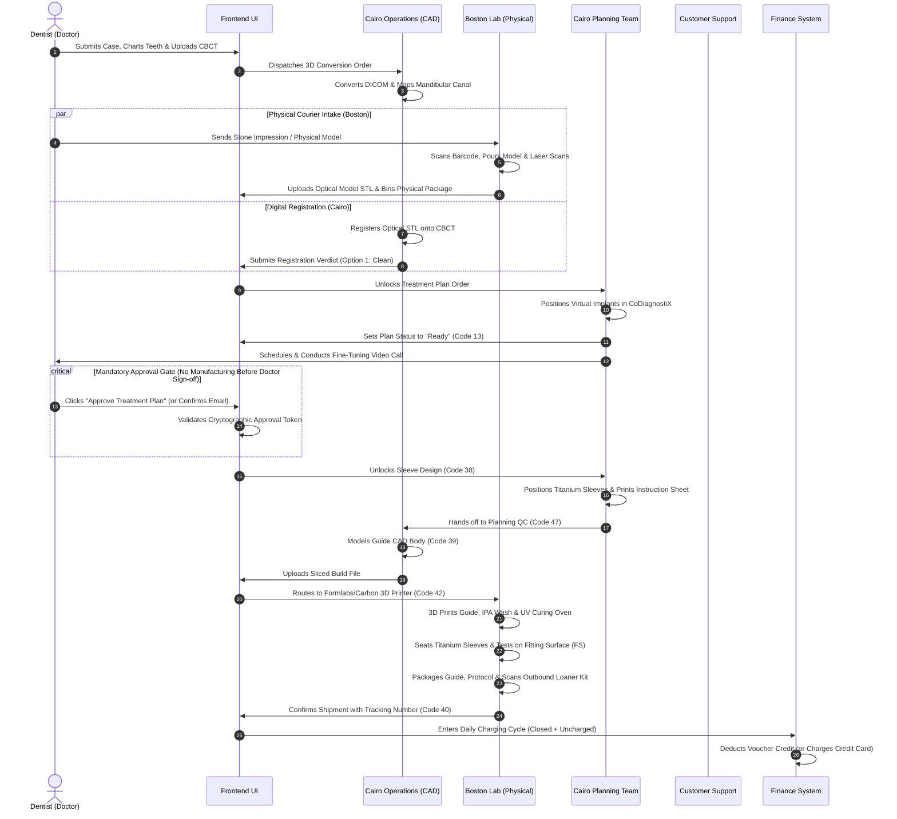

### 6.2 Registration Options 1–4 Decision Sequence
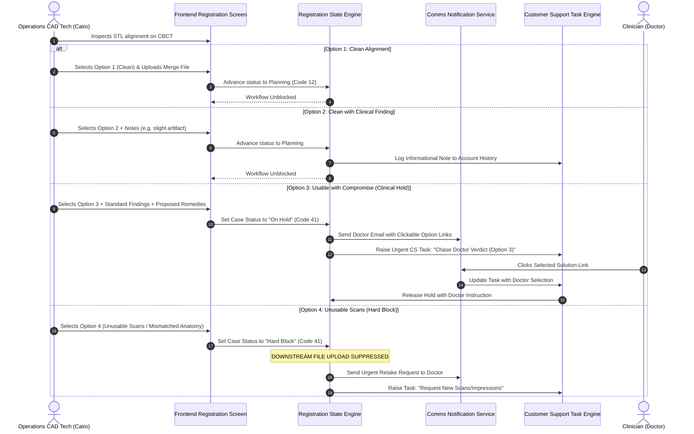

### 6.3 Immutable Voucher Ledger Transaction Sequence
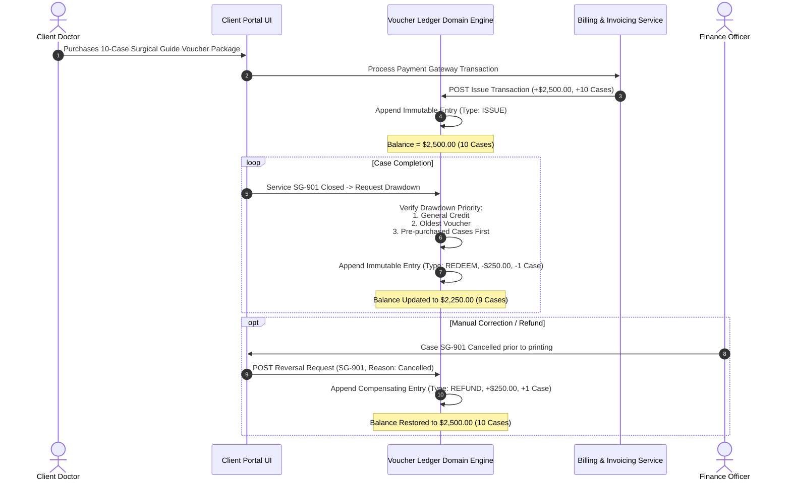

### 6.4 Authentication, PKCE, Token Refresh & Tenant Isolation Sequence
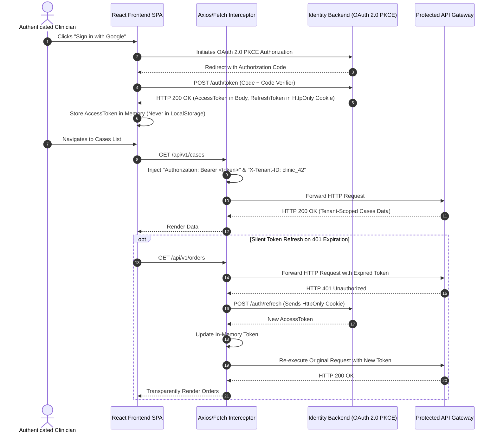

---

## 7. Comprehensive UML State Machine & Activity Diagrams

### 7.1 Surgical Guide Service-Line State Machine (`stateDiagram-v2`)
State integers reflect the exact 3DDX product vocabulary:

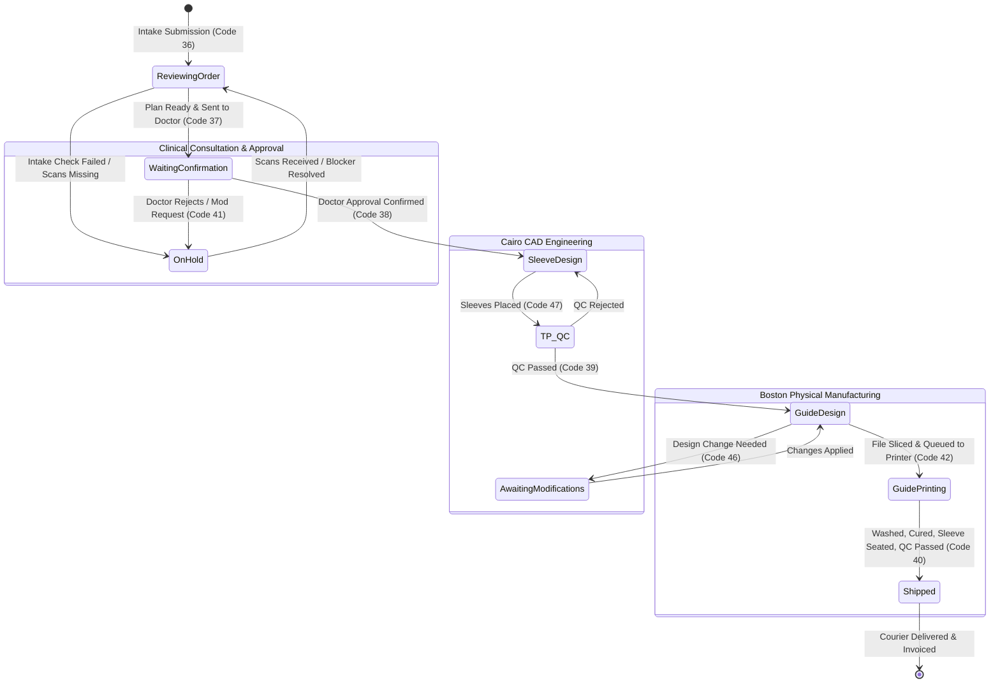

### 7.2 Registration Verdict Activity Diagram
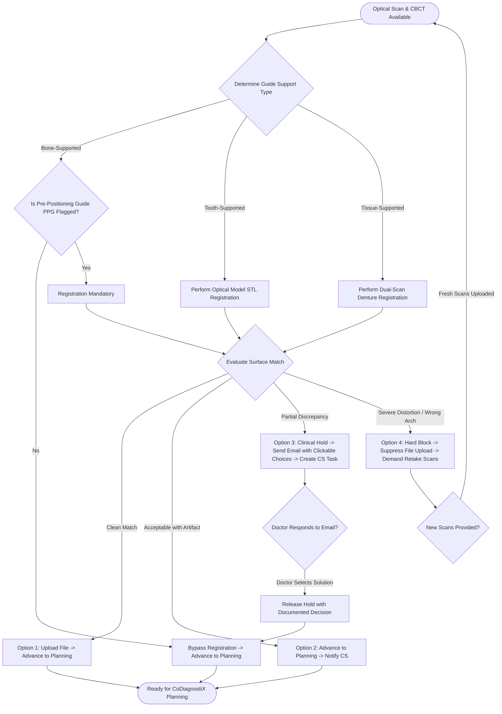

### 7.3 Boston Regulated Manufacturing Activity Flow
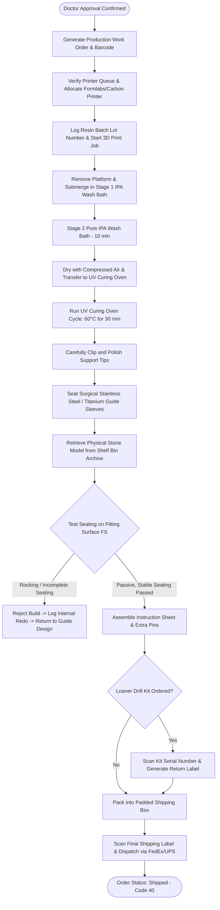

---

## 8. Authentication, Tenant Isolation & Privacy Boundaries

### 8.1 Tenant Context Resolution
- The application enforces strict multi-tenant boundaries. Every outgoing API request carries an authenticated `X-Tenant-ID` header.
- For Dental Support Organizations (DSOs), switching clinics triggers an automatic eviction of the React Query cache to prevent cross-tenant data bleed.

### 8.2 Anonymized Patient Privacy Architecture
In compliance with Section 13.9 of the 3DDX Business Guide:
1. `clinical.patients` contains only `patient_code` and `client_id`.
2. Real patient identities (name, phone, DOB) are isolated in `clinical.patient_identities`.
3. The frontend never displays patient names in standard lists. Clicking "Show Identity" prompts the user for a clinical purpose, dispatching a logged audit event before returning the identity token.

---

## 9. Docker and Containerization Strategy

### 9.1 Multi-Stage Production Dockerfile Design
```dockerfile
# Stage 1: Build Environment
FROM node:22-alpine AS builder
WORKDIR /app
COPY package.json package-lock.json ./
RUN npm ci --prefer-offline --no-audit
COPY . .
RUN npm run build

# Stage 2: Hardened Nginx Runtime
FROM nginx:alpine AS runner
WORKDIR /usr/share/nginx/html
RUN rm -rf ./*
COPY --from=builder /app/dist .
COPY deploy/nginx.conf /etc/nginx/conf.d/default.conf

USER nginx
EXPOSE 8080
HEALTHCHECK --interval=30s --timeout=3s --retries=3 \
  CMD wget --quiet --tries=1 --spider http://localhost:8080/health || exit 1
CMD ["nginx", "-g", "daemon off;"]
```

### 9.2 Custom Nginx Routing & Security Headers (`deploy/nginx.conf`)
- **SPA Fallback Routing:** `try_files $uri $uri/ /index.html;` ensures React Router deep linking functions without 404 errors.
- **Security Headers:** CSP, HSTS, X-Frame-Options, X-Content-Type-Options, Referrer-Policy.

---

## 10. Automated Testing Strategy

| Test Level | Target Framework | Scope & Coverage Targets | Execution Trigger |
|---|---|---|---|
| **Unit Tests** | Vitest | Pure domain functions, pricing calculators, status decoders, voucher drawdowns. Target: > 90% logic coverage. | Pre-commit / CI PR |
| **Component Tests** | Vitest + React Testing Library | UI components, form validations, accessibility keyboard traps, empty/error state handling. | Pre-commit / CI PR |
| **Contract / API Tests** | MSW + Vitest | Verifies that frontend API adapters correctly parse backend JSON payloads against OpenAPI schemas. | CI PR |
| **End-to-End (E2E)** | Playwright (Future Phase) | Critical user journeys: Case creation -> 3D Odontogram -> Approval Gate -> Billing dispatch. | Nightly / Pre-release |

---

## 11. Security, Compliance & Observability

1. **Zero Client Secrets:** All authentication exchanges use OAuth PKCE or server-side session cookies. No API private keys exist in client code.
2. **Cross-Site Scripting (XSS) Mitigation:** React's built-in JSX escaping prevents HTML injection. Raw SVG/HTML rendering is strictly prohibited without DOMPurify sanitization.
3. **Structured Telemetry:** Production errors caught by React Error Boundaries are transmitted with correlation IDs, route context, and anonymized user IDs.

---

## 12. Architectural Decisions Requiring Human Approval

The following critical decisions require explicit sign-off from the Technical Lead and Product Owner before code execution:
1. **Selection of Unit Testing Engine:** Formal adoption of Vitest over Jest for alignment with Vite.
2. **Adoption of TanStack Query:** Replacing `ReactiveStore` with React Query for server-state synchronization.
3. **OpenAPI Specification Freeze:** Confirmation of the final OpenAPI 3.0.3 contract from the backend engineering team.
4. **Approval of FMP/GFMP Status Sequences:** Finalizing the open business question regarding whether FMP/GFMP are independent services, order forms, or bundled workflows.

---

*Authored under Task T-000 governance. Canonical project-level software design specification for `newcp-ui-option-a`.*