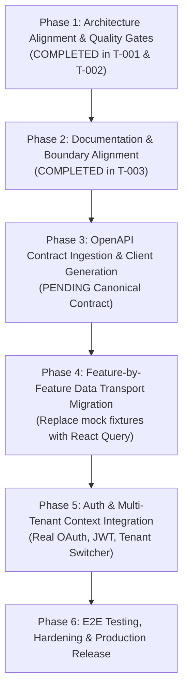

# Current and Target Architecture: New CP UI Option A

**Document Reference:** `ARCH-ALIGN-T003-2026-10-21`  
**Workspace:** `newcp-ui-option-a` (`H:\3DDX\DEMO\newcp-ui-option-a`)  
**Status:** Aligned Baseline Documentation (Post T-001 & T-002)  

---

## 1. Executive Summary & Epistemic Classification

This document aligns the architectural baseline for **New CP UI Option A** following the execution of structural alignment (**Task T-001**) and foundational testing/CI quality gates (**Task T-002**).

All statements throughout this document are classified according to the project's engineering standards:
- `[CONFIRMED FACT]`: Directly verified from repository files, git history, or executed commands.
- `[APPROVED REQUIREMENT]`: Mandated by official project specifications or approved tasks.
- `[EXISTING IMPLEMENTATION]`: Currently present and executing in this codebase.
- `[PROPOSED PRACTICE]`: Recommended target-state design pattern not yet fully implemented.
- `[OPEN QUESTION]`: Undecided item requiring human architect/stakeholder resolution.
- `[BLOCKER]`: Missing dependency or access preventing further implementation.

---

## 2. Final Active & Proposed Folder Structure

`[EXISTING IMPLEMENTATION]` The application source code has been restructured from a flat prototype layout into a domain-driven modular architecture (`app`/`features`/`shared`):

```text
newcp-ui-option-a/
├── .agents/                               # Antigravity agentic governance rules & skills
├── .claude/                               # Claude Code compatibility layer
├── .github/
│   └── workflows/
│       └── ci.yml                         # [EXISTING IMPLEMENTATION] GitHub Actions CI pipeline
├── deploy/
│   └── nginx.conf                         # [EXISTING IMPLEMENTATION] Hardened Nginx runtime config
├── docs/                                  # [EXISTING IMPLEMENTATION] Engineering & architectural governance
│   ├── 00_READ_FIRST.md
│   ├── 00_SOURCE_INVENTORY.md
│   ├── 01_PROJECT/                        # Architecture, conventions, SRS, SDS
│   ├── 02_REQUIREMENTS/                   # Requirements inventory, traceability, open questions
│   ├── 03_WORKFLOW/                       # Workflow, DoD, Abdo ownership boundaries
│   ├── 04_INTEGRATION/                    # OpenAPI contract status
│   ├── 05_QUALITY/                        # Testing strategy, evidence records (T-000, T-002)
│   └── 90_PRODUCT_REFERENCE/              # Clinical reference documentation & TeethChart specs
├── public/
│   ├── data/                              # [EXISTING IMPLEMENTATION] 12 static JSON mock datasets
│   └── favicon.svg, icons.svg...
├── src/
│   ├── app/                               # [EXISTING IMPLEMENTATION] Application bootstrap & shell
│   │   ├── providers/                     # Composed context providers (Theme, Config, Language, ErrorBoundary, Query)
│   │   │   └── __tests__/                 # Provider & ErrorBoundary unit tests
│   │   ├── router/                        # Centralized route tree (35+ screens) & query-param task handlers
│   │   ├── shell/                         # Application layout shell (Header, Sidebar, Navigation, Modals)
│   │   │   └── __tests__/                 # Shell component unit tests
│   │   └── App.tsx                        # Application root entry
│   ├── features/                          # [EXISTING IMPLEMENTATION] Domain feature modules
│   │   ├── auth/                          # Authentication pages (Login, Profile)
│   │   ├── conversion/                    # DICOM Multi-Planar Reconstruction (DicomMprViewer)
│   │   ├── models/                        # 3D Dental Model Work Reports (Task47)
│   │   ├── orders/                        # Core order workflow (Flow, Cases, CreateOrder, WorkflowBoard)
│   │   ├── reporting/                     # Executive & operational telemetry (Dashboard, Targets, Reports)
│   │   └── settings/                      # Tenant & administrative settings (Clinics, Doctors, Billing)
│   ├── shared/                            # [EXISTING IMPLEMENTATION] Cross-cutting reusable assets
│   │   ├── api/                           # API client interfaces, domain errors, and transport models
│   │   │   └── __tests__/                 # Domain error class tests
│   │   ├── components/                    # Atomic UI widgets (Button, DataTable, Avatar, TeethChart, etc.)
│   │   │   └── __tests__/                 # Atomic UI component unit tests
│   │   ├── config/                        # Dynamic application config loader (appConfig.ts)
│   │   ├── data/                          # Shared workflow mock fixtures (flowMockData.ts)
│   │   ├── hooks/                         # Shared React hooks (useFetch, useTableState, useStore)
│   │   ├── services/                      # Data access abstractions (api.ts, reactive store.ts)
│   │   ├── types/                         # Domain TypeScript models & paginated envelopes
│   │   └── utils/                         # Pure utility functions (format, sound, status-styles)
│   │       └── __tests__/                 # Utility unit tests
│   ├── test/
│   │   └── setup.ts                       # [EXISTING IMPLEMENTATION] Vitest global test environment setup
│   ├── theme/                             # [EXISTING IMPLEMENTATION] Theme design tokens
│   └── main.tsx                           # [EXISTING IMPLEMENTATION] Browser bootstrap mounting App.tsx
├── .dockerignore                          # [EXISTING IMPLEMENTATION] Docker build ignore rules
├── Dockerfile                             # [EXISTING IMPLEMENTATION] Multi-stage container definition
├── package.json                           # [EXISTING IMPLEMENTATION] Pinned dependencies & scripts
├── package-lock.json                      # [EXISTING IMPLEMENTATION] Deterministic dependency lockfile
├── tsconfig.json                          # TypeScript project references root
├── tsconfig.app.json                      # Application compiler configuration with path aliases
└── vite.config.ts                         # [EXISTING IMPLEMENTATION] Vite & Vitest configuration
```

---

## 3. Current-State Architecture Assessment

### 3.1 Source & Build Baseline
- `[CONFIRMED FACT]` **Runtime & Core:** React 19.2.8, React DOM 19.2.8, TypeScript ~6.0.2, Vite 8.3.1.
- `[CONFIRMED FACT]` **Path Aliasing:** `@/*`, `@/app/*`, `@/features/*`, `@/shared/*`, and `@/theme/*` active in `tsconfig.app.json` and `vite.config.ts`.
- `[CONFIRMED FACT]` **Testing Foundation:** Vitest v5.0.5 + React Testing Library v16.3.3 + JSDOM v30.1.3 installed and operational. 44 automated tests pass across 7 test suites via `npm run test`.
- `[CONFIRMED FACT]` **Code Quality & Linting:** `oxlint` v1.81.0 active via `npm run lint`. Passes with 0 errors across 118 files (427 pre-existing prototype warnings preserved without breaking changes).
- `[CONFIRMED FACT]` **Production Build:** `npm run build` (`tsc -b && vite build`) emits production assets to `dist/` in under 2.0s.

### 3.2 Data Transport & Boundary State
- `[EXISTING IMPLEMENTATION]` `src/shared/services/api.ts` simulates backend endpoints by fetching static JSON files from `public/data/*.json`.
- `[EXISTING IMPLEMENTATION]` `src/shared/data/flowMockData.ts` provides embedded clinical mock records for complex workflow board views.
- `[CONFIRMED FACT]` **No real backend, database connection, or live API integration currently exists.** All requests execute entirely within the client runtime.
- `[EXISTING IMPLEMENTATION]` `src/shared/api/errors.ts` defines typed domain exceptions (`ApiClientError`, `AuthenticationError`, `TenantAccessDeniedError`, `ClinicalApprovalRequiredError`) preparing the transport layer for real HTTP error mappings.

---

## 4. Target-State Architecture Proposal

`[PROPOSED PRACTICE]` The target architecture transitions New CP UI Option A into an enterprise clinical application consuming the canonical `newcp-api` service:

```text
┌─────────────────────────────────────────────────────────────────┐
│                    React UI Option A Shell                     │
│  (src/app: AppProviders, AppRouter, Navigation Shell, Layout)  │
└─────────────────────────────────┬───────────────────────────────┘
                                  │
┌─────────────────────────────────▼───────────────────────────────┐
│                    Feature Modules (src/features)               │
│     auth | orders | models | conversion | reporting | settings   │
└─────────────────────────────────┬───────────────────────────────┘
                                  │
┌─────────────────────────────────▼───────────────────────────────┐
│                    Feature Query & Mutation Hooks               │
│        (TanStack Query hooks encapsulating cache & sync)        │
└─────────────────────────────────┬───────────────────────────────┘
                                  │
┌─────────────────────────────────▼───────────────────────────────┐
│                    Shared API Transport Layer                   │
│  src/shared/api/generated (OpenAPI client generated from YAML) │
│  src/shared/api/apiClient (Axios/Fetch with auth/tenant headers)│
└─────────────────────────────────┬───────────────────────────────┘
                                  │ HTTPS (OpenAPI 3.0.3 Contract)
┌─────────────────────────────────▼───────────────────────────────┐
│                    New CP Backend (newcp-api)                   │
│     Express / Node.js + Drizzle ORM + PostgreSQL V3 (RLS)       │
└─────────────────────────────────────────────────────────────────┘
```

### Key Target-State Responsibilities:
1. **Feature Encapsulation:** Each feature directory manages its own sub-routes, pages, specialized UI components, and domain-specific query hooks.
2. **OpenAPI-First Integration:** API models and request methods will be code-generated from the canonical `newcp.openapi.yaml` contract.
3. **Data Fetching & Cache:** TanStack Query (`@tanstack/react-query`) will replace the prototype `useFetch` and `store.ts` local storage hydration.
4. **Tenant Isolation:** Every outgoing HTTP request will supply verified multi-tenant headers (`X-Tenant-ID`, `X-Instance-ID`, `Authorization: Bearer <token>`). Direct database queries from frontend remain strictly prohibited.

---

## 5. Incremental Migration Plan

`[PROPOSED PRACTICE]` The migration from current prototype to full production integration is structured across six sequential phases:



1. **Phase 1: Architecture Alignment & Quality Foundation (`[COMPLETED]`)**:
   - Reorganized 95 files into `src/app`, `src/features`, `src/shared`.
   - Established Vitest test runner with 44 unit and component tests.
   - Configured GitHub Actions CI with deterministic `npm ci`, lint, typecheck, tests, build, and Docker validation.
2. **Phase 2: Documentation & Boundary Alignment (`[COMPLETED]`)**:
   - Reconciled engineering documentation with actual repository reality.
   - Formalized Abdo's boundary and open decisions.
3. **Phase 3: OpenAPI Contract Ingestion (`[BLOCKED - Awaiting Canonical YAML]`)**:
   - Ingest canonical `newcp.openapi.yaml` into repository.
   - Set up automated TypeScript client generation (e.g. `openapi-typescript` / `orval`).
4. **Phase 4: Feature-by-Feature Data Transport Migration (`[PENDING Phase 3]`)**:
   - Migrate Orders and Cases modules from `/data/*.json` to typed API queries.
   - Migrate Models and Conversion modules.
   - Preserve existing UI visual design and state switcher capability.
5. **Phase 5: Auth & Multi-Tenant Context Integration (`[PENDING Backend Auth]`)**:
   - Connect login and profile views to real OAuth2/JWT session endpoints.
   - Enforce tenant-scoped request interceptors.
6. **Phase 6: End-to-End Testing & Hardening (`[PENDING Full Integration]`)**:
   - Introduce Playwright for CEO-demo journey tests (Login -> Case -> Model Work -> Report).
   - Container vulnerability scanning and production tagging.

---

## 6. Justified Deviations from Approved Standards

`[CONFIRMED FACT]` The following architectural deviations from the original draft standards exist in this repository and are justified:

| Deviation | Standards Draft Proposal | Actual Implementation | Justification |
|---|---|---|---|
| **Styling Framework** | Migrate to Material UI (MUI) | **Tailwind CSS v4** (`@tailwindcss/vite`) retained | **MUI migration is an unresolved architectural decision pending explicit human approval**; MUI is explicitly excluded from Abdo's personal scope. Retaining Tailwind avoids breaking the working prototype. |
| **Linter Engine** | ESLint standard configurations | **Oxlint** (`oxlint` v1.81.0) | Oxlint executes in < 250ms with 0 configuration drift, catching React compiler and rules-of-hooks violations without heavy plugin overhead. |
| **Test Runner** | Generic testing requirement | **Vitest** (v5) + RTL (v16) | Native integration with Vite 8 bundler, zero duplicated build pipelines, seamless ESM resolution, and fast execution (< 5s). |
| **Repository Topology** | Monorepo or multi-repo discussion | **Single dedicated repository** (`newcp-ui-option-a`) | Option A is independently developed, tested, and containerized as an autonomous deployable artifact. |

---

## 7. Ownership and Responsibility Boundaries

`[APPROVED REQUIREMENT]` Responsibilities across the project are strictly allocated as follows:

```text
┌────────────────────────────────────────────────────────────────────────┐
│               Technical Lead / Project Supervisor                      │
│  - Architecture approvals & RFC sign-off                               │
│  - Business domain rules & field transition authorizations             │
│  - Final PR merge approvals to main                                    │
└───────────────────────────────────┬────────────────────────────────────┘
                                    │
         ┌──────────────────────────┴──────────────────────────┐
         │                                                     │
┌────────▼────────────────────────────┐       ┌────────────────▼───────────────────┐
│     Full-Time Developer / Ops       │       │    Abdo Al Adawy (Full Stack)     │
│  - Backend API (newcp-api) & DB V3  │       │  - Allocation: "5 hours as written"│
│  - Canonical OpenAPI 3.0.3 YAML     │       │  - React UI Option A only          │
│  - SonarQube & Registry Credentials │       │  - NO MUI implementation           │
│  - Option B comparison spike        │       │  - Architecture, Quality, CI Gates │
└─────────────────────────────────────┘       └────────────────────────────────────┘
```

### Abdo Al Adawy Confirmed Scope:
- `[APPROVED REQUIREMENT]` **Allocation:** Preserved strictly as **"5 hours" as written**. No speculative conversion to hours/day or total project duration is inferred.
- `[APPROVED REQUIREMENT]` **Target UI:** React UI Option A exclusively.
- `[APPROVED REQUIREMENT]` **MUI Exclusion:** Material UI (MUI) is strictly **excluded** from Abdo's personal implementation scope.
- `[CONFIRMED FACT]` **Dependencies:** Requires canonical OpenAPI contract, backend endpoint provisioning, and SonarQube secrets from repository administrators.
- `[CONFIRMED FACT]` **Handoffs:** Code changes delivered via documented Pull Requests with passing CI verification, evidence reports, and explicit statements on preserved boundaries.

---

## 8. Testing and CI Quality Gates

`[CONFIRMED FACT]` All quality gates are active in `.github/workflows/ci.yml` and enforced on every push and PR:

1. **Deterministic Dependency Installation:**
   - Command: `npm ci`
   - Policy: No fallback commands (`npm install`) allowed. Fails immediately if `package-lock.json` is out of sync.
2. **Fast Architecture & Code Linting:**
   - Command: `npm run lint` (`oxlint`)
   - Result: 0 errors across 118 files.
3. **Strict TypeScript Compilation:**
   - Command: `npx tsc -b`
   - Result: 0 type errors across application and test source.
4. **Automated Unit & Component Tests:**
   - Command: `npm run test` (`vitest run`)
   - Result: 44 tests passing across 7 suites covering normal, invalid, loading, empty, error, and shell behaviors.
5. **Production Build & Distribution Verification:**
   - Command: `npm run build && test -f dist/index.html`
   - Result: Emits compiled production assets in under 2.0s.
6. **Container Image Validation:**
   - Command: `docker build -t 3ddx-clinical-engine:ci .`
   - Result: Successfully validates the multi-stage Docker build in GitHub Actions runner.
7. **SonarQube Quality Scan (Safe Conditional Integration Point):**
   - Step: `if: ${{ env.SONAR_TOKEN != '' }}`
   - Status: Safe conditional step. Does not fail CI when secrets are absent; automatically engages when administrator provisions `SONAR_TOKEN` and `SONAR_HOST_URL`.

---

## 9. Docker Usage, Configuration, and Limitations

### 9.1 Multi-Stage Architecture (`Dockerfile`)
`[EXISTING IMPLEMENTATION]`
- **Stage 1 (Builder):** `node:22-alpine`
  - Runs deterministic `npm ci --prefer-offline --no-audit`
  - Executes `npm run build` to generate `dist/`
- **Stage 2 (Runner):** `nginx:alpine`
  - Strips default HTML assets
  - Copies compiled artifacts from `/app/dist` to `/usr/share/nginx/html`
  - Copies hardened Nginx configuration (`deploy/nginx.conf`)
  - **Security:** Runs as unprivileged `USER nginx` on port `8080`
  - **Healthcheck:** `wget --quiet --tries=1 --spider http://localhost:8080/ || exit 1` (interval 30s)

### 9.2 Limitations
- `[CONFIRMED FACT]` **Local Environment:** Local Docker daemon socket (`dockerDesktopLinuxEngine`) is not running on the Windows development workstation. Local CLI commands (`docker info`) fail with pipe connection error.
- `[CONFIRMED FACT]` **CI Environment:** Fully operational and validated in GitHub Actions (`ubuntu-latest`).

---

## 10. OpenAPI & Backend Integration Status

- `[CONFIRMED FACT]` **Current Status:** **Pending / Simulated**.
- `[CONFIRMED FACT]` No live backend connection exists. The canonical OpenAPI 3.0.3 specification (`newcp.openapi.yaml`) has not yet been delivered to this frontend repository.
- `[EXISTING IMPLEMENTATION]` All API calls route through `src/shared/services/api.ts` reading JSON fixtures in `public/data/`.
- `[PROPOSED PRACTICE]` Once the backend team provides `newcp.openapi.yaml`, code generation will populate `src/shared/api/generated/` and feature queries will transition systematically.

---

## 11. Unresolved Decision: Tailwind CSS vs React + Material UI (MUI)

`[OPEN QUESTION]` **Status: Unresolved Architectural Decision (Pending Explicit Approval)**

- **Context:** The discussion draft `01_Team_Discussion_and_Execution_Plan.docx` proposed a team-level requirement comparing React + MUI across two designs. However, the existing Option A codebase was fully authored and styled using Tailwind CSS v4.
- **Abdo Boundary:** MUI is explicitly excluded from Abdo's personal implementation scope.
- **Rule:** **No ADR has been created** and **no framework migration has been performed**, because doing so would fabricate an unapproved decision and break the working prototype.
- **Action Required:** The Technical Lead and project stakeholders must formally decide whether Option A:
  1. Retains Tailwind CSS v4 as its production styling system (Recommended for Option A to preserve design integrity and performance).
  2. Undergoes a separate, dedicated MUI conversion task assigned to an owner authorized for MUI work.

---

## 12. Restructuring and Migration Estimate

`[PROPOSED PRACTICE]` Based on direct inspection of the 118 files, 36 page components, and shared services in this repository, the remaining engineering effort is estimated as follows:

| Migration Milestone | Scope & Deliverables | Estimated Effort | Dependencies |
|---|---|---|---|
| **Milestone 1: Contract Setup** | Ingest `newcp.openapi.yaml`, configure `openapi-typescript`, generate types & API clients. | 4 – 6 hours | Canonical OpenAPI YAML from backend team |
| **Milestone 2: Query Infrastructure** | Configure TanStack Query client, global cache defaults, mutation error handlers. | 3 – 5 hours | Milestone 1 |
| **Milestone 3: Core Workflow Migration** | Migrate Orders, Cases, and AddCase views from local fixtures to live API queries. | 8 – 12 hours | Milestone 2, running dev backend |
| **Milestone 4: Secondary Modules Migration** | Migrate Models, Conversion (DICOM), Reporting, and Settings views. | 8 – 10 hours | Milestone 3 |
| **Milestone 5: Auth & Multi-Tenancy** | Replace mock login with real OAuth2/JWT token exchange & tenant header interceptors. | 5 – 7 hours | Backend auth provider & tenant endpoints |
| **Milestone 6: E2E Testing & Hardening** | Implement Playwright critical journey tests & container release validation. | 6 – 8 hours | Stable test environment |
| **Total Estimated Remaining Effort** | **Full end-to-end frontend integration** | **34 – 48 engineering hours** | Backend readiness & contracts |
