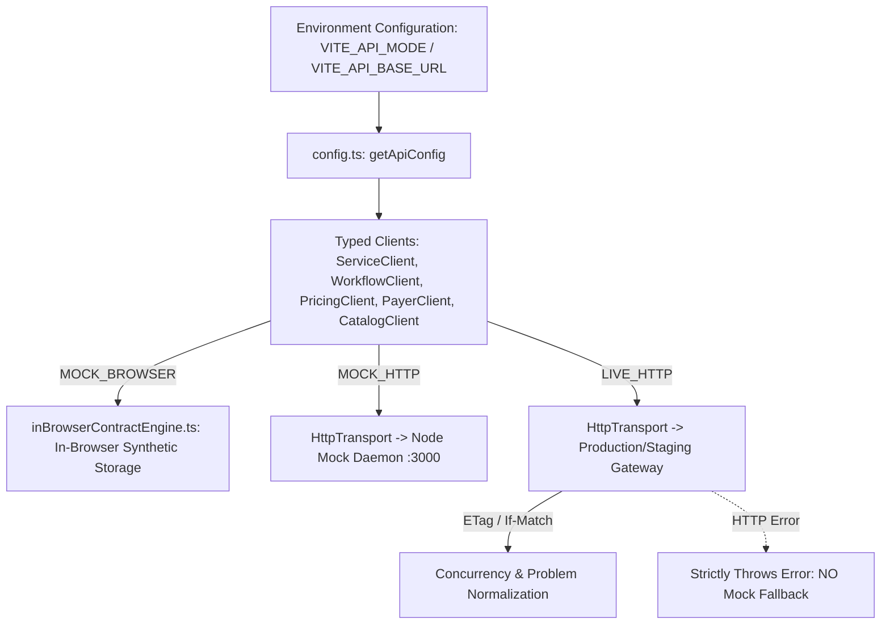

# FE-API-001: OpenAPI Contract Runtime Boundary

**Task ID:** FE-API-001  
**Target Repository:** New CP React Option A (`newcp-ui-option-a`)  
**Scope:** Typed API boundary, transport abstraction, runtime mode switching, and RFC 7807 error normalization.  
**Precedence:** Approved OpenAPI 3.0.3 YAML (`docs/newcp-ai/references/api/newcp.openapi.yaml`) & F07 Draft (`newcp-demo-f07.openapi.yaml`).

---

## 1. Runtime Mode Architecture

The New CP frontend implements a strictly decoupled API runtime boundary with three explicit modes managed entirely via environment configuration:



### 1.1 Mode Definitions

1. **`MOCK_BROWSER` (Default for Offline Dev & Static Demo Deployments):**
   - Pure client-side synthetic simulation powered by `inBrowserContractEngine.ts`.
   - Intercepts synthetic mock requests to replicate full OpenAPI 3.0.3 behaviors (ETags, transitions, on-hold validation, dynamic schema generation, zero-charge rules).
   - Completely offline-resilient; persists demo state locally.

2. **`MOCK_HTTP` (Local / Staging Standalone Daemon):**
   - Routes requests via `HttpTransport` to a local standalone mock HTTP server (e.g. `scripts/mock-server.cjs` on `http://localhost:3000/api/v1`).
   - Validates true cross-process network HTTP request/response serialization, ETag header exchanges, and Problem Details payloads.

3. **`LIVE_HTTP` (Production / Staging Real Gateway):**
   - Routes requests directly to the authoritative backend API gateway via `HttpTransport`.
   - **Strict Fail-Fast Guarantee:** If `VITE_API_BASE_URL` is missing or if the server returns an HTTP error, the transport **immediately throws a normalized `ApiClientError`**. It **never** falls back to localStorage or mock adapters.
   - The in-browser contract engine is guarded with `if (getApiConfig().mode !== 'MOCK_BROWSER') return;` and is completely deactivated.

---

## 2. Configuration & Mode Switching Instructions

Mode switching requires **zero code modifications or component rewrites**. Configuration is driven strictly by environment variables:

| Environment Variable | Allowed Values | Default in Repo | Purpose |
| :--- | :--- | :--- | :--- |
| `VITE_API_MODE` | `MOCK_BROWSER` \| `MOCK_HTTP` \| `LIVE_HTTP` | `MOCK_BROWSER` | Explicitly selects active runtime transport mode. |
| `VITE_API_BASE_URL` | String URL (e.g., `https://api.3ddx.com/v1`) | Empty string `""` | Target API gateway URL. Trailing slashes are automatically sanitized. Required in `LIVE_HTTP`. |
| `VITE_ENABLE_MOCKS` | `true` \| `false` | `true` | Global mock safety toggle. Automatically treated as `false` when `LIVE_HTTP` is active. |

### 2.1 Switching to a Live Backend
To point the frontend to a real OpenAPI 3.0 backend:
```bash
# In .env or hosting environment variables:
VITE_API_MODE=LIVE_HTTP
VITE_API_BASE_URL=https://gateway.3ddx.com/api/v1
VITE_ENABLE_MOCKS=false
```

### 2.2 Switching to Local HTTP Mock Server
```bash
VITE_API_MODE=MOCK_HTTP
VITE_API_BASE_URL=http://localhost:3000/api/v1
VITE_ENABLE_MOCKS=true
```

### 2.3 Switching to In-Browser Static Demo Mode
```bash
VITE_API_MODE=MOCK_BROWSER
VITE_API_BASE_URL=
VITE_ENABLE_MOCKS=true
```

---

## 3. Transport Boundary Implementation Details

### 3.1 Request Construction (`src/shared/api/httpTransport.ts`)
- **Default Headers:** All requests automatically inject `Accept: application/json` and `Content-Type: application/json`.
- **Concurrency Injection:** When an `ifMatch` option is provided, it is attached as the standard `If-Match` HTTP header (e.g., `If-Match: W/"v42"`).
- **Tenant & Authentication:** Injects `X-Tenant-ID` and `Authorization: Bearer <token>` when context providers supply credentials.
- **Base URL Validation:** If `mode === 'LIVE_HTTP'` and `baseUrl` is empty, `request()` immediately throws an `ApiClientError(500, 'Configuration Error: VITE_API_BASE_URL must be defined when running in LIVE_HTTP mode.')`.

### 3.2 Response ETag Extraction
- Every successful HTTP response wraps data in an `HttpResponse<T>` containing:
  - `data: T`
  - `status: number`
  - `headers: Headers`
  - `etag: string | null` (extracted directly via `res.headers.get('ETag')`).
- Concurrency managers and typed clients store the received ETag to guard subsequent mutations.

### 3.3 RFC 7807 Problem Error Normalization (`src/shared/api/errors.ts`)
When non-2xx responses are received, the payload is normalized via `normalizeProblemError(status, payload)` into contract-accurate error classes:

| HTTP Status | Normalized Error Class | OpenAPI Problem Code | Meaning / Resolution |
| :---: | :--- | :--- | :--- |
| **401** | `AuthenticationError` | `UNAUTHORIZED` | Session expired or token missing; redirect to login. |
| **403** | `TenantAccessDeniedError` / `PermissionDeniedError` | `FORBIDDEN` / `PERMISSION_DENIED` | Caller lacks required role or tenant permission. |
| **404** | `ProblemError` | `NOT_FOUND` | Service instance or order does not exist. |
| **409** | `ClinicalApprovalRequiredError` | `CONFLICT` / `CLINICAL_APPROVAL_REQUIRED` | Business lock (e.g. payer change after invoice or unapproved clinical manufacturing). |
| **412** | `PreconditionFailedError` | `STALE_PRECONDITION` | Concurrency version mismatch (`If-Match` did not match current `ETag`). Reload required. |
| **422** | `ValidationError` | `VALIDATION_ERROR` | Schema validation failed; includes invalid field breakdown. |
| **428** | `PreconditionRequiredError` | `PRECONDITION_REQUIRED` | Mutation missing required `If-Match` concurrency header. |

---

## 4. UI Independence & Payer Safety Gates

1. **Complete UI Decoupling:**
   - Page components (`OrderDetailsPage.tsx`, `AddCase.tsx`, `SubOrderDetail.tsx`, `OrderWorkflow.tsx`) interact exclusively with high-level typed clients (`serviceClient`, `workflowClient`, `pricingClient`, `payerClient`, `catalogClient`).
   - UI components contain zero `fetch()` calls, zero hardcoded URLs, and zero direct localStorage manipulation.
2. **F07 Payer Safety Gate (`PROPOSAL_PENDING_BACKEND_REVIEW`):**
   - Per `F07_DECISION_AND_RELEASE_GATES.md`, live V204 migration and database ETL stage-90 reconciliation are unverified in this repository.
   - The frontend exposes `PayerClient` with `readonly status = PROPOSAL_PENDING_BACKEND_REVIEW`.
   - Real database writes for Bill To remain disabled until authoritative backend verification is provided.
3. **Public UI Cleanliness:**
   - All internal engineering route aliases (`/api-contract`, `/contract`), debug banners, and contract explorer navigation pills are purged from public components.

---

## 5. Automated Verification & Test Coverage

Automated tests in `src/shared/api/__tests__/apiModeAndLiveHttp.test.ts` verify:
1. Mode selection derivation for `MOCK_BROWSER`, `MOCK_HTTP`, and `LIVE_HTTP`.
2. Clean sanitization of base URL trailing slashes.
3. Fail-fast error throwing when base URL is missing in `LIVE_HTTP`.
4. Header injection for `Accept`, `Content-Type`, and `If-Match`.
5. Accurate ETag extraction from response headers.
6. RFC 7807 error mapping across all contract status codes (401, 403, 404, 409, 412, 422, 428).
7. Strict failure without fallback in `serviceClient`, `workflowClient`, and `pricingClient`.
8. Routing cleanliness ensuring no internal contract explorer routes exist in public application navigation.
