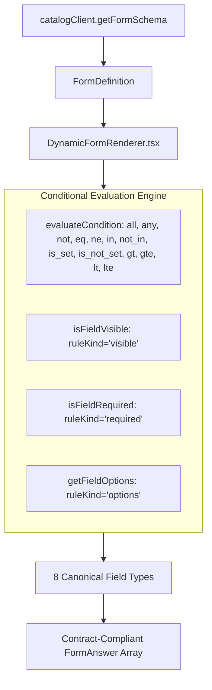

# FE-FORM-001: Typed Dynamic Catalog Form Renderer

**Task ID:** FE-FORM-001  
**Target Repository:** New CP React Option A (`newcp-ui-option-a`)  
**Scope:** Typed metadata-driven form renderer for approved Biomodel and Conversion services.  
**Authority:** OpenAPI 3.0.3 specification (`docs/newcp-ai/references/api/newcp.openapi.yaml`), `form_biomodel.json`, `form_conversion.json`.

---

## 1. Architectural Overview

The New CP dynamic form subsystem renders clinical questions directly from tenant catalog schemas (`GET /api/v1/catalog/services/{serviceUuid}/form-schema`). The frontend renderer (`DynamicFormRenderer.tsx`) is entirely metadata-driven, ensuring page components (`AddCase.tsx`, `SubOrderDetail.tsx`, `OrderDetailsPage.tsx`) remain decoupled from service-specific question structures.

---

## 2. Supported Canonical Field Types

The renderer implements exactly the 8 canonical field data types specified by OpenAPI 3.0.3 (`CanonicalFieldType`):

| Canonical Type | Storage Representation | UI Component Presentation | Validation & Constraints |
| :--- | :--- | :--- | :--- |
| **`text`** | `value` / `valueText` (string) | Single-line text input | Max length, pattern regex |
| **`number`** | `value` / `valueNumber` (number) | Numeric input with step | Min, max numeric bounds |
| **`boolean`** | `value` / `valueBoolean` (boolean) | Accessible checkbox toggle (Yes/No) | Boolean state |
| **`date`** | `value` / `valueDate` (ISO string) | Standard HTML5 date picker input | Date format |
| **`single_select`** | `optionCode` / `optionCodes[0]` | Single-choice pill buttons or select menu | Exactly 1 option selected |
| **`multi_select`** | `optionCodes` (string array) | Multi-choice checkbox toggle buttons | 0 or more options selected |
| **`file`** | `value` (string filename/UUID) | File upload input with active attachment label | File attachment reference |
| **`tooth_chart`** | `value` (string array of tooth IDs) | Interactive FDI / ISO dental arch tooth selector | Selected teeth codes |

### Unsupported Field Type Handling
If metadata contains an unknown or uncatalogued field type, the renderer fails safely by rendering an accessible diagnostic banner (`Unsupported field type: '<type>'`) without crashing the application shell or page container.

---

## 3. Supported Rule Concepts & Evaluation Logic

The rule engine strictly evaluates the 3 documented rule concepts:
1. **`visible`**: When rule condition evaluates to false, the field is unmounted from the DOM and its value is excluded from outgoing answers.
2. **`required`**: When rule condition evaluates to true, the field dynamically becomes mandatory, rendering an asterisk (`*`) and blocking submission if unpopulated.
3. **`options`**: When rule condition evaluates to true, the field's available options are dynamically filtered to the subset specified in `rule.optionCodes`.

### 3.1 Supported Operators
- `eq`: Exact value equality ($a == b$).
- `ne`: Value inequality ($a \neq b$).
- `in`: Value exists in allowed set ($a \in \text{set}$).
- `not_in`: Value does not exist in allowed set ($a \notin \text{set}$).
- `is_set`: Value is defined, non-null, and non-empty.
- `is_not_set`: Value is undefined, null, or empty string/array.
- `gt`: Numeric strictly greater than ($a > b$).
- `gte`: Numeric greater than or equal to ($a \ge b$).
- `lt`: Numeric strictly less than ($a < b$).
- `lte`: Numeric less than or equal to ($a \le b$).

### 3.2 Supported Combinators
- `all`: Logical AND ($\bigwedge_{i} C_i$). Evaluates to true if every child condition is satisfied.
- `any`: Logical OR ($\bigvee_{i} C_i$). Evaluates to true if at least one child condition is satisfied.
- `not`: Logical negation ($\neg C$). Inverts the child condition result.

---

## 4. Biomodel & Conversion Form Implementation

### 4.1 Biomodel 3D Printing Schema (`MOCK_BIOMODEL_FORM_SCHEMA`)
- Sourced from `docs/newcp-ai/references/v06/form_biomodel.json`.
- Questions:
  - `model_type` (`single_select`): Solid Arch (`solid`), Hollow Arch with Hygienic Drain (`hollow`). Default: `solid`.
  - `wall_thickness_mm` (`number`): Permitted range `[1.5, 4.0]`. **Conditional:** Visible and required **only** when `model_type == 'hollow'`.
  - `is_digital_design` (`boolean`): Digital Design Only toggle.
  - `arch_selection` (`single_select`): Maxilla (`upper`), Mandible (`lower`), Dual Arch (`both`). Default: `upper`.
  - `target_teeth` (`tooth_chart`): Interactive tooth chart selector for diagnostic models.
  - `delivery_date` (`date`): Scheduled lab delivery date.
  - `clinical_notes` (`text`): Special staging notes.

### 4.2 Conversion Service Schema (`MOCK_CONVERSION_FORM_SCHEMA`)
- Sourced from `docs/newcp-ai/references/v06/form_conversion.json`.
- Questions:
  - `software` (`single_select`): `simplant`, `codiagnostix`, `bsb`. Default: `simplant`.
  - `format` (`single_select`):
    - When `software == 'simplant'`, options are dynamically filtered to `['planner', 'pro', 'viewer', 'master', 'oneshot']`.
    - When `software == 'codiagnostix'`, options are dynamically filtered to `['casexchange', 'connect']`.
    - Hidden when `software == 'bsb'`.
  - `arch_type` (`single_select`): `maxilla`, `mandible`, `both`.
  - `conversion_notes` (`text`): Alignment and software version directives.

---

## 5. Verification & Test Suite

The automated test suite in `src/shared/components/__tests__/DynamicFormRenderer.test.tsx` verifies 8 test suites:
1. **Rendering supported field types:** Verifies all 8 canonical types render without error.
2. **Required field validation:** Asterisk rendering and validation blocking on empty fields.
3. **Conditional visibility:** `wall_thickness_mm` appears only when `model_type == 'hollow'`.
4. **Conditional requiredness:** Required validation applies dynamically based on dependent values.
5. **Conditional options:** `format` options change dynamically between Simplant and coDiagnostiX.
6. **Invalid metadata handling:** Graceful fallback banner when metadata is malformed.
7. **Server validation errors:** Direct display of RFC 7807 problem details mapped to field codes.
8. **Unsupported type handling:** Non-crashing diagnostic alert when unknown field types are provided.
