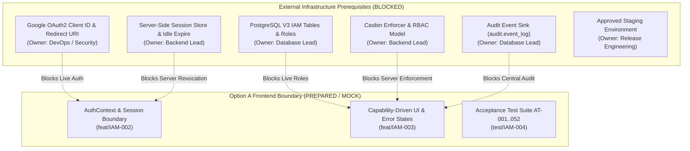

# IAM-001 — Read-Only IAM Readiness and Gap Resolution Assessment

**Repository:** `newcp-ui-option-a` (Option A React Frontend)  
**Handoff Package:** `NewCP_Approved_IAM_Developer_Handoff_v0.9.5_2026-10-26`  
**Evaluation Date:** October 26, 2026  
**Status:** READ-ONLY ASSESSMENT COMPLETE — NO UNAUTHORIZED PRODUCT CODE MODIFICATIONS

---

## 1. Executive Summary & Assessment Objective

This assessment compares the approved New CP IAM v0.9.5 / v1.2 specifications against the current Option A React application. The objective is to identify confirmed requirements, existing frontend facts, architectural gaps, and explicit blockers across authentication, session management, PostgreSQL V3 IAM, Casbin authorization, tenant isolation, role hierarchy, and audit logging.

In strict adherence to the project charter:
- Google Sign-In authenticates identity only. Google Groups are completely excluded.
- PostgreSQL V3 IAM and Casbin backend enforcement are authoritative. Frontend visibility is never treated as security.
- Email domains (`@3ddx.com`) do not automatically grant role or tenant permissions.
- October demo tenant is explicitly authorized `tenant_id=1`.
- Unassigned authenticated users receive Pending Access; protected APIs return `403 ACCESS_NOT_ASSIGNED`.
- Reports are viewable by all five business families (`CS`, `OPS`, `FINANCE`, `QC`, `ADMIN`); report export is restricted to `FINANCE`, `QC`, and `ADMIN`.
- No live IAM, OAuth, Casbin, database migrations, or production integration is claimed.

---

## 2. Confirmed Business Requirements Baseline

| Requirement ID | Topic | Authoritative Baseline Rule | Status |
| :--- | :--- | :--- | :--- |
| **IAM-001** | Interactive Authentication | Google Sign-In is the sole interactive employee login for the October demo; password login paths are excluded. | **CONFIRMED** |
| **IAM-002** | User Provisioning | Eligible `@3ddx.com` or explicitly approved demo identities can link as internal users without automatic role or tenant grants. | **CONFIRMED** |
| **IAM-003** | Authorization Authority | PostgreSQL V3 IAM assignments and capabilities evaluated by backend Casbin; Google Groups are strictly prohibited. | **CONFIRMED** |
| **IAM-004** | Role Administration | Role assignment is restricted to tenant-scoped `ADMIN`; all mutations must be auditable. | **CONFIRMED** |
| **IAM-005** | Pending Access | Authenticated users without assigned roles/tenants see a restricted Pending Access view; APIs return `403 ACCESS_NOT_ASSIGNED`. | **CONFIRMED** |
| **IAM-006** | Demo Tenant | October demo tenant is explicitly `tenant_id=1`; domain matching never implies tenant authorization. | **CONFIRMED** |
| **IAM-007** | Tenant Scope | Exactly one active tenant per demo session; cross-tenant operations strictly denied. | **CONFIRMED** |
| **IAM-008** | Admin Boundary | `ADMIN` has full functional capabilities within authorized tenants; does not grant cross-tenant super-admin. | **CONFIRMED** |
| **IAM-009** | Report Viewing | All five business families (`CS`, `OPS`, `FINANCE`, `QC`, `ADMIN`) may view sanitized tenant reports. | **CONFIRMED** |
| **IAM-010** | Report Export | Only `FINANCE`, `QC`, and `ADMIN` may export/download reports; backend must enforce independently of UI. | **CONFIRMED** |
| **IAM-011** | Session Timeout | 30-minute idle timeout and 8-hour absolute session lifetime enforced server-side. | **CONFIRMED** |
| **IAM-012** | Revocation & Refresh | Role changes apply on the next protected request; logout revokes the server session. | **CONFIRMED** |
| **IAM-013** | Audit Integrity | Security-relevant events and denials recorded without tokens, secrets, or patient PHI. | **CONFIRMED** |
| **IAM-014** | CS Scope | Operational customer service within approved scope; no financial transactions, QC audits, or admin rights. | **CONFIRMED** |
| **IAM-015** | OPS Scope | Operational Biomodel & Conversion management and approved commercial overrides only. | **CONFIRMED** |
| **IAM-016** | Finance / QC Scope | Finance executes financial transactions; QC performs audits and exports without operational editing. | **CONFIRMED** |
| **IAM-017** | Commercial Edits | Price, billability, zero-charge reason, and Bill To edits are subject to financial locks (`isInvoiced`), ETag checks, and audit. | **CONFIRMED** |
| **IAM-018** | Multiple Roles | Architecture supports additive union of role capabilities; multi-role demo testing is deferred. | **CONFIRMED** |
| **IAM-019** | Step-Up Authentication | Sensitive-action Google step-up is deferred; session validity and backend checks remain mandatory. | **DEFERRED** |
| **IAM-020** | Demo Identities | Maximum 3 live Google accounts (CS, OPS, ADMIN); Finance and QC use automated test fixtures. | **CONFIRMED** |
| **IAM-022** | No Google Groups | Zero Google Workspace Groups API calls, group token claims, or group-to-role mappings. | **CONFIRMED** |
| **IAM-023** | Casbin Engine | Casbin enforcer on backend evaluates all protected requests against V3 IAM assignments. | **CONFIRMED** |
| **IAM-024** | Granular Staff Roles | Granular internal roles (e.g. Senior Ops, Junior Ops) preserved; staff not collapsed into 5 physical rows. | **CONFIRMED** |
| **IAM-HIER-001** | Transitive Hierarchy | Senior/Manager roles inherit direct and transitive capabilities of verified subordinate roles in the same family. No reverse, cross-family, or cross-tenant inheritance. | **CONFIRMED** |

---

## 3. Current Option A Repository Audit & Facts

| Component / Subsystem | Current Repository State | Alignment with IAM v0.9.5 | Required Remediation |
| :--- | :--- | :--- | :--- |
| **Interactive Login (`Login.tsx`)** | Password input, email input (`jessica.ruiz@3ddx.com`), simulated role selector (`director`, `clinician`, `doctor`, `planner`, etc.), and forgot password modal. | **NON-COMPLIANT (MOCK)**: Uses password form; role list reflects legacy demo roles rather than the 5 business families; lacks Google identity boundary. | Introduce a provider-agnostic Google login boundary; present explicit demo identity presets (`CS`, `OPS`, `ADMIN`, `Pending Access`); remove password authority. |
| **Auth Context & Provider** | `src/app/providers/` has `ThemeContext`, `LanguageContext`, `ConfigContext`, `ErrorBoundary`, `QueryProvider`. No `AuthContext` exists. | **MISSING**: Application relies on ad-hoc `localStorage.getItem('3ddx-auth')` and `localStorage.getItem('3ddx-user-role')`. | Implement `AuthContext` with typed session states (`unauthenticated`, `authenticating`, `authenticated`, `pending_access`, `expired`, `revoked`). |
| **Session Lifetime & Idle Expiry** | No session tracking, idle timeout timer, or absolute expiration logic in frontend. | **MISSING**: Client remains logged in indefinitely until manual clear. | Implement client-side session timeout awareness (30m idle, 8h max) triggering re-authentication prompts. |
| **Protected Route Handling (`router/index.tsx`)** | Unprotected layout routes; any user can directly navigate to `/flow`, `/order-details`, `/reports`, `/billing`, `/config-manager`. | **NON-COMPLIANT**: No route guard checking authentication status or Pending Access. | Implement `ProtectedRoute` / `AuthBoundary` redirecting unauthenticated users to `/login` and unassigned users to `PendingAccessView`. |
| **Authorization & Capability Hints** | Basic permission hints on `ServiceItem` (`canEditPrice`, `canEditBillability`, `canEditService`, `canTransition`, `isInvoiced`). | **PARTIAL (PREPARED)**: Existing service-level hints are well-structured, but no unified `useAuthorization()` hook exists for UI capabilities. | Create a typed `useAuthorization()` hook checking server-derived capabilities without hardcoding role strings. |
| **Tenant Scope Handling** | Tenant IDs are hardcoded or absent; no backend-derived tenant context. | **NON-COMPLIANT**: Does not enforce single-tenant context (`tenant_id=1`). | Expose active tenant as backend-derived immutable session context (`tenantId: 1`). |
| **Report Export Affordances** | Export buttons on `Reports.tsx`, `QuarterTargetsReport.tsx`, `Task47ModelWorkReport.tsx` are enabled for all users. | **NON-COMPLIANT**: Violates IAM-010 (export restricted to Finance, QC, Admin). | Restrict export UI controls to `FINANCE`, `QC`, and `ADMIN` capabilities; display disabled state with clear tooltip for other roles. |
| **Audit Logging & Denial Sink** | No security audit logging mechanism; client errors only trigger local console/toasts. | **MISSING**: Security denials (`401`, `403`) are not logged to an auditable sink. | Implement a client-side audit dispatcher that logs security denials without tokens, secrets, or PHI. |
| **Backend Casbin / PostgreSQL** | No PostgreSQL database or Casbin engine exists in this client repository. | **BLOCKED (EXTERNAL DEPENDENCY)**: Real authorization enforcement belongs to backend. | Maintain offline mock boundary; label all authorization claims `MOCK / SYNTHETIC`. |

---

## 4. API Error Contract Alignment

The frontend must strictly align with the documented error contract without conflating HTTP status codes:

| HTTP Status | Error Code | Business Meaning | Option A UI Action |
| :--- | :--- | :--- | :--- |
| **401 Unauthorized** | `AUTHENTICATION_REQUIRED` / `SESSION_EXPIRED` | Unauthenticated request, expired idle/absolute session, or revoked token. | Invalidate local session state; redirect to `/login` with explanatory notification. |
| **403 Forbidden** | `ACCESS_NOT_ASSIGNED` | Google authenticated, but user has no assigned internal role or tenant grant. | Display dedicated **Pending Access** view (`PendingAccessView.tsx`); block access to operational routes. |
| **403 Forbidden** | `PERMISSION_DENIED` | Authenticated user lacks required capability for the requested action. | Display inline permission-denied alert; disable action affordance. |
| **403 Forbidden** | `TENANT_ACCESS_DENIED` | Request targets a tenant outside the user's authorized session scope (`tenant_id !== 1`). | Display tenant boundary denial banner; prevent cross-tenant leakage. |
| **404 Not Found** | `RESOURCE_NOT_FOUND` | Inaccessible resource masked to prevent metadata or entity existence leakage. | Render standard 404 view without revealing resource existence. |
| **409 Conflict** | `FINANCIAL_LOCK_CONFLICT` | Service item is invoiced (`isInvoiced: true`) or month-end locked. | Display amber lock banner; disable financial mutations. |
| **409 Conflict** | `WORKFLOW_CONFLICT` | Workflow transition invalid from current state or clinical approval required. | Display workflow conflict modal with available transitions. |
| **412 Precondition Failed** | `STALE_PRECONDITION` | Concurrency conflict; `If-Match` aggregate ETag does not match current server revision. | Preserve unsaved user draft; render "Reload Latest Server Version & Compare" banner. |
| **422 Unprocessable** | `ZERO_CHARGE_REASON_REQUIRED` | Line total is 0.00 but mandatory `zeroChargeReasonCode` was omitted. | Highlight `zeroChargeReasonCode` input field with specific validation message. |
| **428 Precondition Required** | `PRECONDITION_REQUIRED` | Mutating request (`PATCH`, transition) submitted without required `If-Match` header. | Prevent submission; refresh ETag from server before retry. |

---

## 5. Missing Backend & Infrastructure Dependencies (Blockers)

The following prerequisites are outside the scope of this React repository and require Backend, Database, and DevOps resolution:

1. **Google OAuth 2.0 Client Infrastructure:** Missing Google Cloud project, OAuth Client ID, client secret, and authorized redirect URIs. *(Owner: DevOps / Security)*
2. **PostgreSQL V3 IAM Schema:** `V006__iam_tables.sql` lacks an immutable Google `sub` identity mapping table and lacks `last_activity_at` on `iam.user_sessions`. *(Owner: Database Lead)*
3. **Casbin Policy Enforcer:** No live Casbin middleware or rule engine deployed to enforce role capabilities. *(Owner: Backend Lead)*
4. **Audit Denial Event Code:** `audit.event_log` CHECK constraint lacks a `permission_denied` / `authorization_denied` event code. *(Owner: Database Lead)*
5. **Staging Environment:** No deployed staging server with network ingress to test live Google SSO or Casbin decisions. *(Owner: Release Engineering)*

---

## 6. Deferred Requirements Register

In accordance with `DEFERRED_REGISTER.csv`:
- **F01 (Domain Auto-Grant):** Do not infer tenant or roles from `@3ddx.com`; explicit assignment required.
- **F02 (External Email Allowlist):** Demo allowlist exception is not a general external user policy.
- **F03 (Multi-Tenant Switching):** Single tenant (`tenant_id=1`) per session for the October demo.
- **F04 (Google Groups):** Completely excluded; no Google Groups APIs, claims, or directory sync.
- **F05 (Report Field Masking):** Column-level report masking deferred; sanitized demo data used.
- **F06 (Step-Up Authentication):** Google re-authentication challenge for high-value actions deferred.
- **F07 (Multi-Role Testing):** Additive role union supported in schema/types, but multi-role integration testing deferred.
- **F08 (Cross-Tenant Super-Admin):** `ADMIN` role is strictly tenant-scoped.
- **F09 (Non-Google Interactive Login):** Google is the sole interactive employee login method for October.

---

## 7. Recommended Bounded Implementation Roadmap

To align the frontend truthfully without faking backend integration, the work is divided into four strictly bounded follow-up tasks:

1. **`feat/IAM-002-frontend-auth-session-boundary`**:
   - Implement `AuthContext` supporting all 6 session states (`unauthenticated`, `authenticating`, `authenticated`, `pending_access`, `expired`, `revoked`).
   - Implement client session timeout tracker (30m idle, 8h absolute).
   - Implement `ProtectedRoute` and `PendingAccessView`.
   - Update `Login.tsx` with Google Sign-In boundary and approved demo identity presets.
2. **`feat/IAM-003-permission-aware-frontend-boundary`**:
   - Implement `useAuthorization()` hook for capability-driven affordances.
   - Restrict report export buttons across reporting views to `FINANCE`, `QC`, and `ADMIN`.
   - Standardize API error interceptors for `401`, `403 ACCESS_NOT_ASSIGNED`, `403 PERMISSION_DENIED`, `409`, `412`, and `422`.
3. **`test/IAM-004-iam-acceptance-coverage`**:
   - Add unit and synthetic contract tests for scenarios AT-001..AT-052.
4. **`docs/IAM-005-backend-runtime-blockers`**:
   - Create documentation-only blocker register detailing all backend, database, and infrastructure prerequisites.
