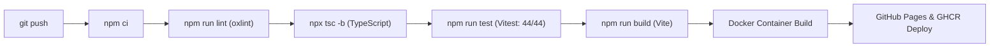

# 🛡️ Quality Gates & CI/CD Automation

The repository enforces four automated quality gates before any code reaches production.

### Quality Pipeline

### Automation Workflows

1. **`ci.yml`**: Triggers on pull requests and commits to `main`. Runs full quality verification.
2. **`deploy-pages.yml`**: Automatically builds and publishes the production SPA to GitHub Pages at [https://abdo2000-1.github.io/newcp-ui-option-a/](https://abdo2000-1.github.io/newcp-ui-option-a/).
3. **`package.yml`**: Packages and pushes the multi-stage Docker container image to GitHub Container Registry (`ghcr.io/abdo2000-1/newcp-ui-option-a:v4.2.0`).
